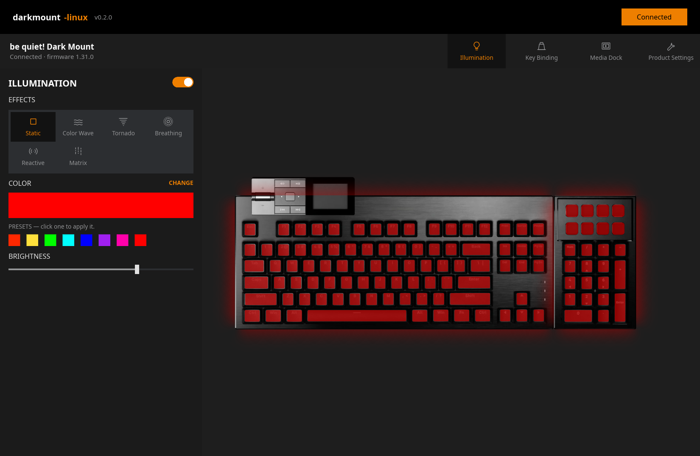

# darkmount-linux

Unofficial, **offline** Linux control for the **be quiet! Dark Mount** keyboard:
lighting, key remapping (including the Fn layer and the numpad display keys),
game mode, media dock settings and its keys, dock clock sync and **firmware
updates**. There's a desktop app, a command-line tool and a background helper
service, written in Rust and shipped together as one small AppImage (~12 MB, no
runtime dependencies).

The vendor's own configuration software is Windows-only, or a web app that needs
an internet connection. This project talks to the keyboard directly over
`/dev/hidraw` and never goes online.



> **Not affiliated with be quiet!** “be quiet!” and “Dark Mount” are trademarks
> of their respective owner and are used here only to say which hardware this
> software supports. See [Notice](#notice).

Tested on firmware 1.19.0 and 1.31.0 (main board, media dock and numpad), ANSI/US
layout, including a full 1.19.0 → 1.31.0 firmware update.

## Setup

Give your user access to the keyboard (once):

```bash
sudo cp 70-bequiet-darkmount.rules /etc/udev/rules.d/
sudo udevadm control --reload-rules && sudo udevadm trigger
# then unplug and re-plug the keyboard
```

The desktop app can also install this rule for you (it asks for your password).

## Desktop app

| Section | What you can do |
|---|---|
| Illumination | effect (Static, Color Wave, Tornado, Breathing, Reactive, Matrix), single/dual/spectrum colours, brightness, speed, direction. Animated live preview |
| Key Binding | click a key on the rendered keyboard and assign a key or shortcut, media, mouse, lighting control, system shortcut, **Linux command**, open file/folder/website, or disable. Separate Fn layer |
| Media Dock | menu colour, idle screen (image/clock), 12/24 h clock, screen-off timer, clock sync. Click one of the dock's four keys to rebind it |
| Product Settings | firmware versions and updates, game mode and blocked keys, layout, helper service on/off, start in tray at login |

### Install

Downloads are on the [Releases](https://github.com/RJCogburn/darkmount-linux-oss/releases)
page. They're built on an older system (glibc 2.28), so they run on Ubuntu 20.04+,
Debian 10+, Linux Mint 20+, Fedora 29+, RHEL/AlmaLinux/Rocky 8+, openSUSE Leap 15 /
Tumbleweed, Arch and others of that age or newer (x86_64).

| Your system | Get | Install |
|---|---|---|
| Debian, Ubuntu, Mint, Pop!_OS | `darkmount-linux_<version>-1_amd64.deb` | `sudo apt install ./darkmount-linux_*.deb` |
| Fedora, openSUSE, RHEL-like | `darkmount-linux-<version>-1.x86_64.rpm` | `sudo dnf install ./darkmount-linux-*.rpm` or `sudo zypper install ./darkmount-linux-*.rpm` |
| Arch, Manjaro, EndeavourOS | AUR: `darkmount-linux` | `yay -S darkmount-linux` (`PKGBUILD` in `packaging/aur/`) |
| Any distribution, no install | `darkmount-linux-x86_64.AppImage` | `chmod +x` it and run it |
| Any distribution, installed | `darkmount-linux-<version>-x86_64.tar.gz` | unpack, then `./install.sh` (for your user) or `./install.sh --system` |

The .deb, .rpm and AUR packages install the udev rule; the `.tar.gz` installer asks
for your password to install it. With the AppImage, use **Grant access** in the app
the first time.

AppImage tips:

```bash
./darkmount-linux-x86_64.AppImage darkmount info     # the `darkmount` command (also: --cli info)
ln -s "$PWD/darkmount-linux-x86_64.AppImage" ~/.local/bin/darkmount   # then just `darkmount …`
```

**From source** (Rust 1.88 or newer; on Debian/Ubuntu also `libfontconfig1-dev`):

```bash
cargo build --release                # target/release/darkmount-linux and target/release/darkmount
./target/release/darkmount-linux     # finds assets/ in the source tree
packaging/build-appimage.sh          # -> dist/darkmount-linux-x86_64.AppImage
packaging/build-packages.sh          # -> dist/*.tar.gz, and .deb/.rpm when nfpm is installed
```

For a system install by hand, put the two programs in `/usr/bin` and `assets/` in
`/usr/share/darkmount-linux/assets` (`$DARKMOUNT_ASSETS` overrides the location).

**System tray:** closing the window keeps the app in the tray. Its menu has backlight
on/off, effect, brightness, game mode, dock clock sync and Quit. While hidden it
releases the keyboard, so the background service keeps working. *Start in tray at
login* (Product Settings) adds an autostart entry; `--tray` starts hidden, and
launching the app again brings up the running instance.

## Command line

`darkmount` is a single program with no dependencies (from the AppImage, or
`target/release/darkmount`).

```bash
darkmount info                      # serial, firmware, layout, current settings

darkmount light set --effect static --color ff2800 --brightness 80
darkmount light set --effect colorwave --gradient ff0000,00ff00,0000ff --direction right
darkmount light off | on

darkmount keys list                          # current custom bindings
darkmount keys set CapsLock --to Escape      # remap (combos: ctrl+shift+T, super+E, …)
darkmount keys set Fn+F12 --media MicMute    # Fn layer
darkmount keys set Image0 --open-url https://example.com
darkmount keys reset CapsLock
darkmount keys names                         # all key and action names

darkmount gamemode on | off
darkmount gamemode block win,alt-tab,alt-f4

darkmount dock set --clock 24 --menu-color dc4d00 --screensaver clock
darkmount dock sync-time

darkmount firmware status           # installed vs. downloaded firmware
darkmount firmware download         # fetch the latest from the vendor's server (online)
darkmount firmware install          # back up settings, update, restore settings
darkmount firmware install --from DIR   # offline: folder with index.json + .bin files

darkmount backup save | list | restore [FILE]
```

`--debug` prints every raw 64-byte frame.

## Background service

Toggle **Linux helper service** in the app's Product Settings: it installs a
systemd user service that runs this copy of the program (the AppImage, or the
`darkmount` installed next to the app). By hand:

```bash
cp systemd/darkmount-clock.service ~/.config/systemd/user/   # adjust ExecStart if needed
systemctl --user enable --now darkmount-clock.service
```

The service:

* syncs the media dock clock on connect, after suspend/resume and every 10 minutes;
* performs **open file / open folder / open website** key actions. The keyboard
  only reports these to host software. Everything else (media keys, Win+E,
  Win+L, Sleep and so on) is sent by the keyboard itself as normal key presses;
* runs your own commands from `~/.config/darkmount/config.toml`:

```toml
[actions]
Image0 = "flatpak run org.gimp.GIMP"
"Fn+F12" = "konsole"
```

The numpad display keys are `Image0`–`Image7`, left to right, top row first.
**Run Linux command** in the app sets up both the key binding and the config entry.

## Firmware updates

`darkmount firmware install` (or **Check for updates → Install** in the app) follows
the vendor's update sequence: the keyboard reboots into its bootloader (USB PID
`0009`), receives the images for the main board, media dock and numpad (32-byte
chunks, ~3 minutes), validates and commits them, and reboots. Firmware is downloaded
from the vendor's own update server (it is not included in this repository) and
every image is checked against the SHA-512 in the vendor manifest before flashing.

* Updates **reset the keyboard's settings to factory defaults**. The tool backs them
  up first and restores them afterwards (`~/.local/share/darkmount/backups/`).
* If an update is interrupted, the keyboard stays in its bootloader: it can't type,
  but it isn't bricked. Run the install again (or press *Finish firmware update* in
  the app) and it resumes where it stopped.
* Use at your own risk. Don't unplug the keyboard or suspend the computer while it
  updates.

Firmware 1.31 only accepts changes from the oldest open session. The background
service steps aside automatically whenever the app or CLI talks to the keyboard and
reconnects ~5 s after they're done. Display-key Linux actions pause while the app is
open.

## Protocol notes

The keyboard speaks a vendor protocol ("QLink") over 64-byte HID reports on the
vendor collection (usage page `0xFF00`), with no report ID:

| byte | field |
|------|-------|
| 0 | payload length (data + 6) |
| 1 | sequence id, bit 7 = more frames |
| 2 | session id |
| 3 | status (0 = success) |
| 4 | request id |
| 5 | feature (1 root, 3 device info, 6 usb, 7 keyboard, 16 lighting, 17 bindings, 18 macros, 32 numpad, 33 media dock) |
| 6 | command |
| 7.. | data |
| 62–63 | CRC-16/Modbus of bytes 0–61, little-endian |

* Sessions: `ROOT/OpenSession` (session 0, data = random u32 + client type
  1 = desktop app, 2 = web), kept alive with `ROOT/KeepAlive` every timeout/2 s.
  Several sessions can coexist, and inactive ones can still write.
* `BINDINGS/ActionFired` notifications (`[key, layer, handled_by_device, type,
  payload…]`) are only sent to client-type-1 sessions.
* Binding records: `[key id, layer (0x00 / 0x80 = Fn), type, data…]`. The Fn
  layer must be `0x80`; `0x01` is rejected on 1.19.0. `GetBindings` returns
  stale data for ~1 s after a write.

See `crates/core/src/darkmount/` (`qlink.rs`, `device.rs`, `bindings.rs`) for the details.

## Notice

This is an independent, unofficial project. It is not affiliated with, endorsed by
or supported by be quiet! or Listan GmbH. Use at your own risk.

The keyboard renders and layout data in `assets/dark_mount/` originate
from the vendor's configuration software. The vendor logo has been removed
(`packaging/remove_logo.py`, a one-off PySide6 script), and the assets are included only to depict the
hardware this software controls. If you are the rights holder and want them
removed, please open an issue.

The Inter font (`assets/fonts/`) is © The Inter Project Authors and
licensed under the SIL Open Font License 1.1.
